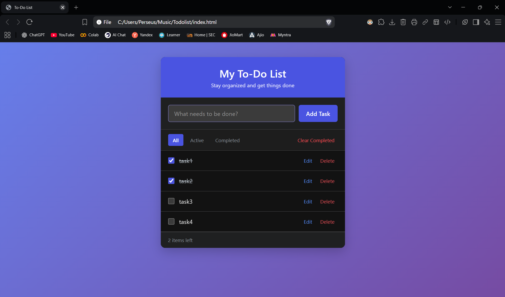

# Ex03 To-Do List using JavaScript
## Date:
17/11/2026

## AIM
To create a To-do Application with all features using JavaScript.

## ALGORITHM
### STEP 1
Build the HTML structure (index.html).

### STEP 2
Style the App (style.css).

### STEP 3
Plan the features the To-Do App should have.

### STEP 4
Create a To-do application using Javascript.

### STEP 5
Add functionalities.

### STEP 6
Test the App.

### STEP 7
Open the HTML file in a browser to check layout and functionality.

### STEP 8
Fix styling issues and refine content placement.

### STEP 9
Deploy the website.

### STEP 10
Upload to GitHub Pages for free hosting.

## PROGRAM

### `index.html`
```html
<!DOCTYPE html>
<html lang="en">
<head>
    <meta charset="UTF-8">
    <meta name="viewport" content="width=device-width, initial-scale=1.0">
    <title>To-Do List</title>
    <link rel="stylesheet" href="style.css">
</head>
<body>
    <div class="todo-container">
        <header>
            <h1>My To-Do List</h1>
            <p class="subtitle">Stay organized and get things done</p>
        </header>

        <form id="todo-form" class="todo-form">
            <input 
                type="text" 
                id="todo-input" 
                placeholder="What needs to be done?" 
                autocomplete="off"
                required
            />
            <button type="submit" id="add-btn">Add Task</button>
        </form>

        <div class="filter-section">
            <div class="filters">
                <button type="button" class="filter-btn active" data-filter="all">All</button>
                <button type="button" class="filter-btn" data-filter="active">Active</button>
                <button type="button" class="filter-btn" data-filter="completed">Completed</button>
            </div>
            <button type="button" id="clear-completed" class="clear-btn">Clear Completed</button>
        </div>

        <ul id="todo-list" class="todo-list"></ul>

        <footer class="todo-footer">
            <span id="items-left">0 items left</span>
        </footer>
    </div>

    <script src="script.js"></script>
</body>
</html>
```

### `style.css`
```css
* {
    margin: 0;
    padding: 0;
    box-sizing: border-box;
    font-family: 'Segoe UI', Tahoma, Geneva, Verdana, sans-serif;
}

body {
    background: linear-gradient(135deg, #667eea 0%, #764ba2 100%);
    min-height: 100vh;
    display: flex;
    justify-content: center;
    align-items: flex-start;
    padding: 40px 20px;
}

.todo-container {
    background: #ffffff;
    width: 100%;
    max-width: 500px;
    border-radius: 12px;
    box-shadow: 0 10px 30px rgba(0, 0, 0, 0.2);
    overflow: hidden;
    display: flex;
    flex-direction: column;
}

header {
    background: #4a54e1;
    color: #ffffff;
    padding: 24px;
    text-align: center;
}

header h1 {
    font-size: 1.8rem;
    font-weight: 600;
}

header .subtitle {
    font-size: 0.9rem;
    opacity: 0.85;
    margin-top: 4px;
}

.todo-form {
    display: flex;
    padding: 20px;
    gap: 10px;
    background: #f8f9fa;
    border-bottom: 1px solid #e9ecef;
}

.todo-form input {
    flex: 1;
    padding: 12px 16px;
    border: 1px solid #ced4da;
    border-radius: 6px;
    font-size: 1rem;
    outline: none;
    transition: border-color 0.2s;
}

.todo-form input:focus {
    border-color: #4a54e1;
}

.todo-form button {
    background-color: #4a54e1;
    color: white;
    border: none;
    padding: 12px 20px;
    border-radius: 6px;
    font-size: 1rem;
    font-weight: 500;
    cursor: pointer;
    transition: background-color 0.2s;
}

.todo-form button:hover {
    background-color: #3b43b6;
}

.filter-section {
    display: flex;
    justify-content: space-between;
    align-items: center;
    padding: 12px 20px;
    background: #fdfdfd;
    border-bottom: 1px solid #e9ecef;
    font-size: 0.9rem;
}

.filters {
    display: flex;
    gap: 6px;
}

.filter-btn {
    background: transparent;
    border: 1px solid transparent;
    padding: 6px 12px;
    border-radius: 4px;
    cursor: pointer;
    font-size: 0.85rem;
    color: #6c757d;
    transition: all 0.2s;
}

.filter-btn:hover {
    background: #e9ecef;
}

.filter-btn.active {
    background: #4a54e1;
    color: #ffffff;
    font-weight: 600;
}

.clear-btn {
    background: transparent;
    border: none;
    color: #dc3545;
    cursor: pointer;
    font-size: 0.85rem;
    padding: 6px 8px;
    border-radius: 4px;
    transition: opacity 0.2s;
}

.clear-btn:hover {
    text-decoration: underline;
}

.todo-list {
    list-style: none;
    max-height: 380px;
    overflow-y: auto;
}

.todo-item {
    display: flex;
    align-items: center;
    padding: 14px 20px;
    border-bottom: 1px solid #f1f3f5;
    gap: 12px;
    transition: background 0.15s;
}

.todo-item:hover {
    background: #fbfbfb;
}

.todo-item.completed .todo-text {
    text-decoration: line-through;
    color: #adb5bd;
}

.todo-item input[type="checkbox"] {
    width: 18px;
    height: 18px;
    cursor: pointer;
    accent-color: #4a54e1;
}

.todo-text {
    flex: 1;
    font-size: 1rem;
    color: #333;
    word-break: break-word;
}

.todo-item .btn-group {
    display: flex;
    gap: 6px;
}

.todo-item button {
    background: transparent;
    border: none;
    cursor: pointer;
    padding: 4px 8px;
    font-size: 0.85rem;
    border-radius: 4px;
    transition: background-color 0.2s;
}

.edit-btn {
    color: #0d6efd;
}

.edit-btn:hover {
    background-color: #e7f1ff;
}

.delete-btn {
    color: #dc3545;
}

.delete-btn:hover {
    background-color: #ffe6e6;
}

.todo-footer {
    display: flex;
    justify-content: space-between;
    align-items: center;
    padding: 12px 20px;
    background: #f8f9fa;
    color: #6c757d;
    font-size: 0.85rem;
    border-top: 1px solid #e9ecef;
}

.empty-state {
    text-align: center;
    padding: 30px 20px;
    color: #adb5bd;
    font-size: 0.95rem;
}
```

### `script.js`
```javascript
// Select DOM elements
const todoForm = document.getElementById('todo-form');
const todoInput = document.getElementById('todo-input');
const todoList = document.getElementById('todo-list');
const itemsLeftSpan = document.getElementById('items-left');
const clearCompletedBtn = document.getElementById('clear-completed');
const filterBtns = document.querySelectorAll('.filter-btn');

// State variables
let todos = JSON.parse(localStorage.getItem('todos')) || [];
let currentFilter = 'all';

// Initialize the application
function init() {
    renderTodos();
    setupEventListeners();
}

// Setup Event Listeners
function setupEventListeners() {
    todoForm.addEventListener('submit', (e) => {
        e.preventDefault();
        const taskText = todoInput.value.trim();
        if (taskText !== '') {
            addTodo(taskText);
            todoInput.value = '';
            todoInput.focus();
        }
    });

    clearCompletedBtn.addEventListener('click', clearCompleted);

    filterBtns.forEach((btn) => {
        btn.addEventListener('click', () => {
            filterBtns.forEach((b) => b.classList.remove('active'));
            btn.classList.add('active');
            currentFilter = btn.dataset.filter;
            renderTodos();
        });
    });
}

// Save tasks to localStorage
function saveToLocalStorage() {
    localStorage.setItem('todos', JSON.stringify(todos));
}

// Add a new task
function addTodo(text) {
    const newTodo = {
        id: Date.now(),
        text: text,
        completed: false
    };
    todos.push(newTodo);
    saveToLocalStorage();
    renderTodos();
}

// Toggle complete status
function toggleTodo(id) {
    todos = todos.map((todo) => {
        if (todo.id === id) {
            return { ...todo, completed: !todo.completed };
        }
        return todo;
    });
    saveToLocalStorage();
    renderTodos();
}


function deleteTodo(id) {
    todos = todos.filter((todo) => todo.id !== id);
    saveToLocalStorage();
    renderTodos();
}

function editTodo(id) {
    const todo = todos.find((t) => t.id === id);
    if (!todo) return;

    const newText = prompt('Edit your task:', todo.text);
    if (newText !== null && newText.trim() !== '') {
        todo.text = newText.trim();
        saveToLocalStorage();
        renderTodos();
    }
}

// Clear all completed tasks
function clearCompleted() {
    todos = todos.filter((todo) => !todo.completed);
    saveToLocalStorage();
    renderTodos();
}

// Update task counter
function updateItemsLeft() {
    const activeCount = todos.filter((todo) => !todo.completed).length;
    itemsLeftSpan.textContent = `${activeCount} ${activeCount === 1 ? 'item' : 'items'} left`;
}

// Render tasks to the DOM
function renderTodos() {
    todoList.innerHTML = '';

    const filteredTodos = todos.filter((todo) => {
        if (currentFilter === 'active') return !todo.completed;
        if (currentFilter === 'completed') return todo.completed;
        return true;
    });

    if (filteredTodos.length === 0) {
        const emptyLi = document.createElement('li');
        emptyLi.className = 'empty-state';
        emptyLi.textContent = todos.length === 0 ? 'No tasks yet. Add one above!' : 'No tasks in this view.';
        todoList.appendChild(emptyLi);
    } else {
        filteredTodos.forEach((todo) => {
            const li = document.createElement('li');
            li.className = `todo-item ${todo.completed ? 'completed' : ''}`;

            const checkbox = document.createElement('input');
            checkbox.type = 'checkbox';
            checkbox.checked = todo.completed;
            checkbox.addEventListener('change', () => toggleTodo(todo.id));

            const span = document.createElement('span');
            span.className = 'todo-text';
            span.textContent = todo.text;

            const btnGroup = document.createElement('div');
            btnGroup.className = 'btn-group';

            const editBtn = document.createElement('button');
            editBtn.className = 'edit-btn';
            editBtn.textContent = 'Edit';
            editBtn.addEventListener('click', () => editTodo(todo.id));

            const deleteBtn = document.createElement('button');
            deleteBtn.className = 'delete-btn';
            deleteBtn.textContent = 'Delete';
            deleteBtn.addEventListener('click', () => deleteTodo(todo.id));

            btnGroup.appendChild(editBtn);
            btnGroup.appendChild(deleteBtn);

            li.appendChild(checkbox);
            li.appendChild(span);
            li.appendChild(btnGroup);

            todoList.appendChild(li);
        });
    }

    updateItemsLeft();
}

init();
```


## OUTPUT


## RESULT
The program for creating To-do list using JavaScript is executed successfully.
